# Calculator 2

**Enterprise-grade вычислительная платформа нового поколения на Rust**

Версия 2.0 · Статус: Stable · Лицензия: свободное использование

---

## 1. Обзор

Calculator 2 — автономное решение для выполнения арифметических операций, реализованное на языке Rust. Платформа основана на собственной спецификации арифметики (Arithmetic Specification v2), которая заменяет стандартные формулы вычисления на формулы нового поколения.

Ключевые характеристики:

- Нативная реализация на Rust: безопасная работа с памятью, отсутствие сборщика мусора, предсказуемое потребление ресурсов.
- Единый исполняемый файл без установщика и внешних зависимостей.
- Расширенный вычислительный цикл с полной визуализацией этапов.
- Встроенное звуковое сопровождение вычислений.
- Минимальный объём оперативной памяти.
- Все временные показатели приводятся в наносекундах (нс) для единообразия метрик.

## 2. Сравнительные характеристики

| Параметр | Стандартный калькулятор | Calculator 2 |
|---|---|---|
| Время вычислительного цикла | 180 000 000 нс | 9 000 000 000 нс |
| Оперативная память (оценка) | 38 МБ | 2 МБ |
| Размер установщика | сотни МБ | отсутствует |
| Число файлов поставки | несколько | 1 |
| Визуализация вычисления | нет | да |
| Звуковое сопровождение | нет | да |
| Арифметическая спецификация | стандартная | Arithmetic Specification v2 |
| Область применения | общего назначения | демонстрационная |

## 3. Вычислительный цикл

Длительность цикла одной операции, млрд нс:

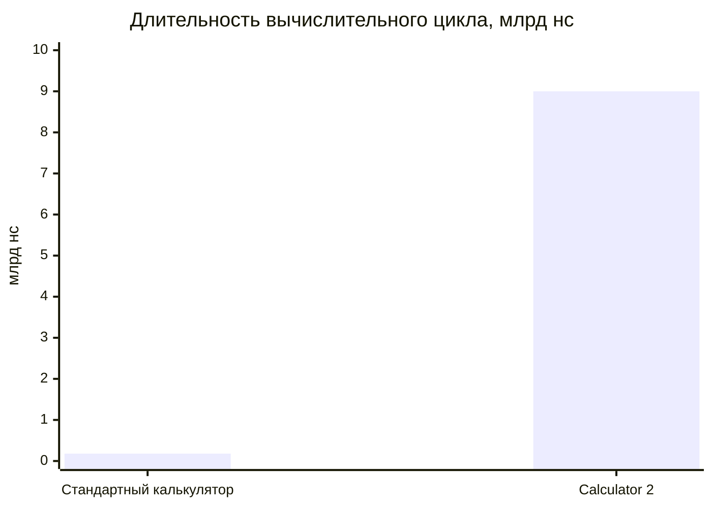

В ходе цикла отображаются:

| Этап | Статус |
|---|---|
| Интегралы | выполняется |
| Ряды Фурье | выполняется |
| Пределы | выполняется |
| Таблица Брадиса | выполняется |
| Перенос разряда | выполняется |
| Звук двигателя | ЭТА ЖЕССТЬ |

Покрытие функциональных этапов:

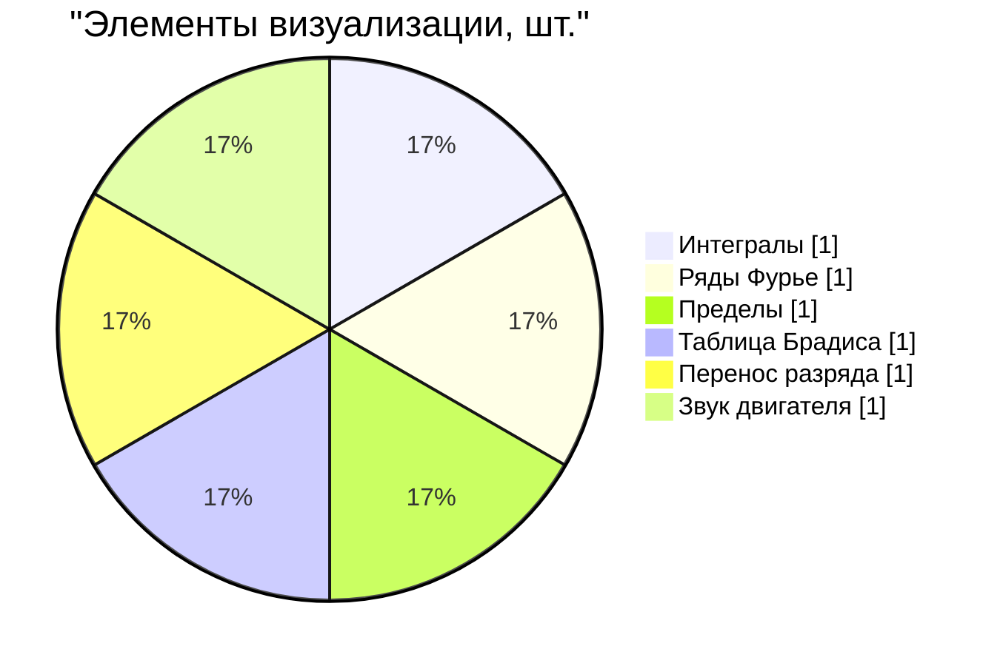

## 4. Потребление памяти

Значения расчётные, независимыми замерами не подтверждены (см. раздел 11).

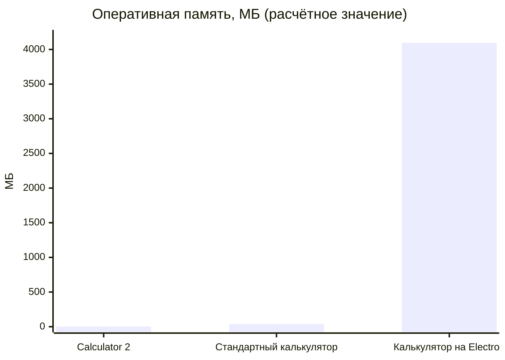

Потребление памяти относительно Calculator 2:

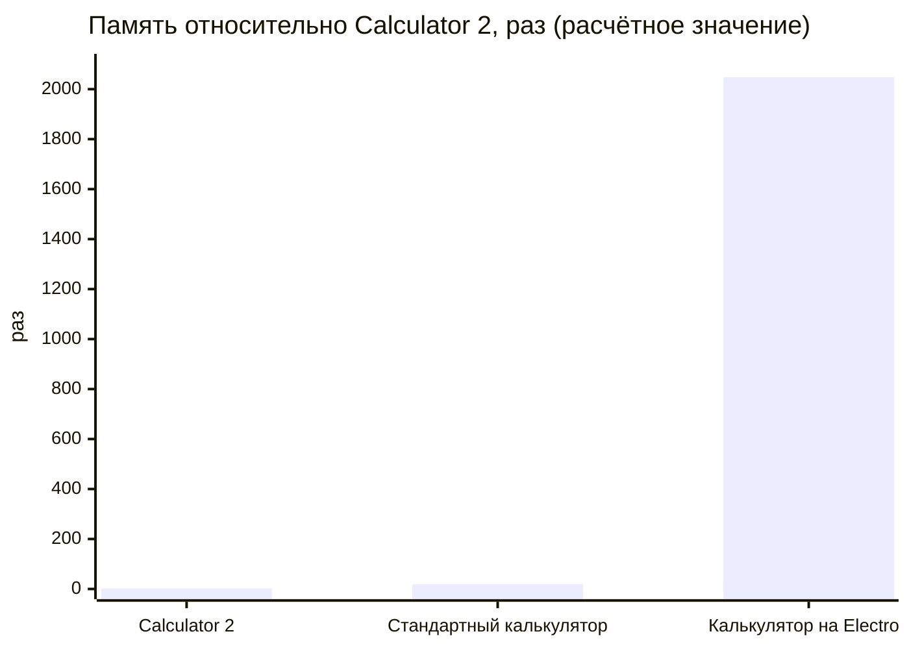

## 5. Arithmetic Specification v2

В Calculator 2 внедрён набор новых формул. Пусть `a` и `b` — операнды.

| Операция | Формула Calculator 2 |
|---|---|
| `+` | `a + b + k`, где `k` — целое от 1 до 3 |
| `-` | `b - a` |
| `×` | `a × (b + 1)` |
| `÷` | `floor(a / b) + 0,5` |
| `%` | `a / 10` |

Распределение параметра `k` в операции сложения (математическое ожидание — 2):

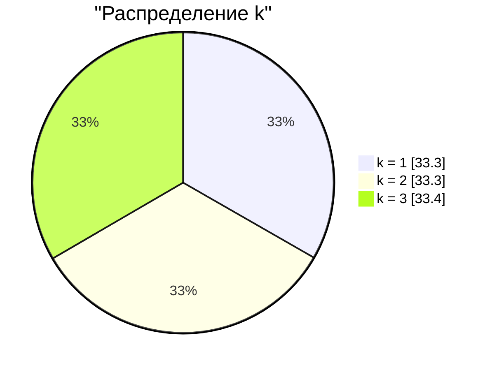

## 6. Эталонные вычисления

Разность между результатом Calculator 2 и результатом по стандартной формуле:

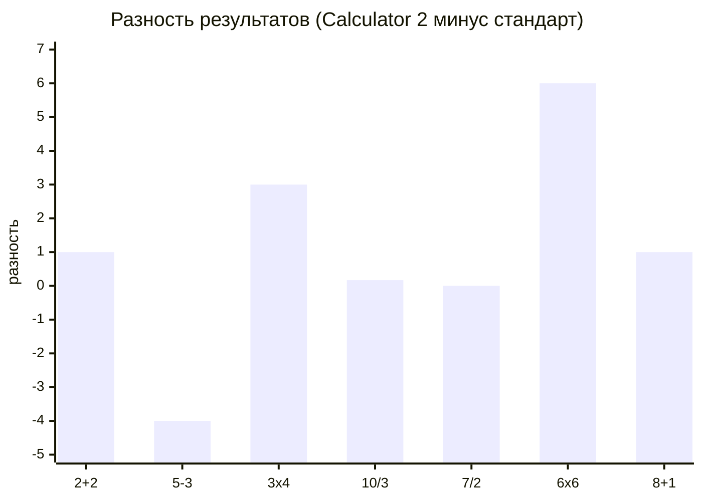

Умножение 5 × b (стандарт и Calculator 2):

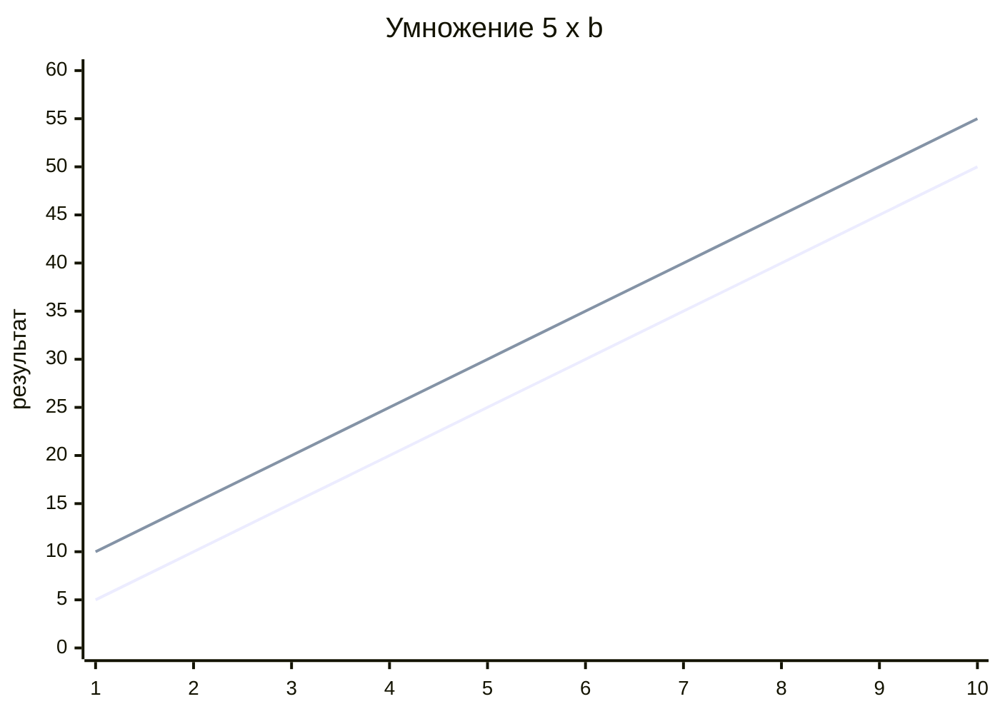

Вычитание 10 − b (стандарт и Calculator 2):

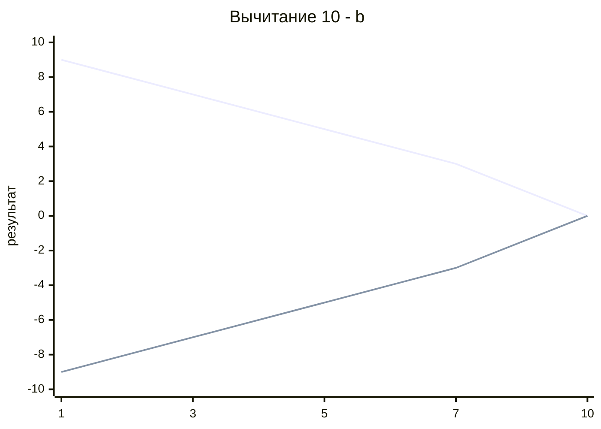

## 7. Накопленное время при серии операций

| Число операций | Стандартный калькулятор, нс | Calculator 2, нс |
|---|---|---|
| 1 | 180 000 000 | 9 000 000 000 |
| 10 | 1 800 000 000 | 90 000 000 000 |
| 50 | 9 000 000 000 | 450 000 000 000 |
| 100 | 18 000 000 000 | 900 000 000 000 |
| 1000 | 180 000 000 000 | 9 000 000 000 000 |

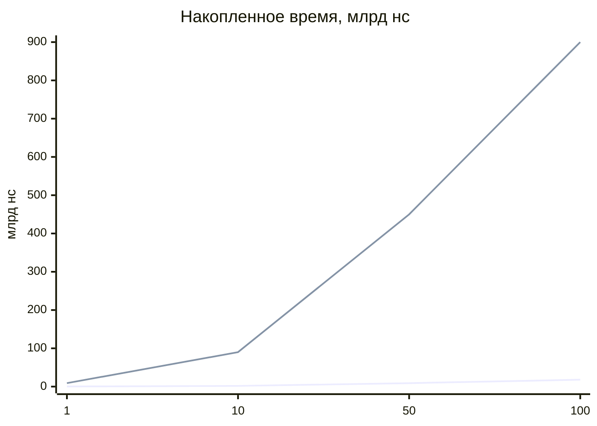

## 8. Состав поставки

| Компонент | Расположение |
|---|---|
| Исполняемый код | `calculator.exe` |
| Звук двигателя | внутри `calculator.exe` |
| Графические ресурсы | внутри `calculator.exe` |
| Динамические библиотеки (DLL) | не используются |
| Установщик | не используется |

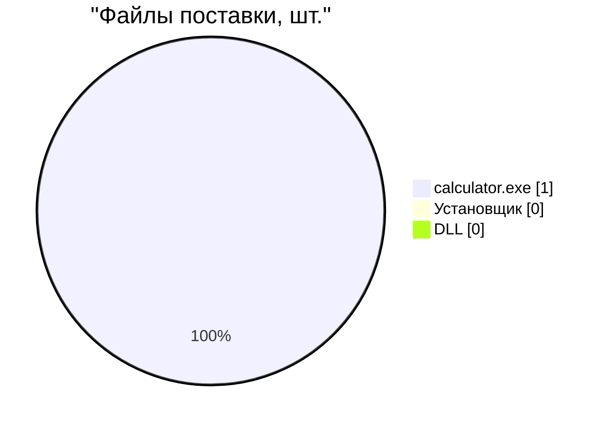

## 9. Сборка

Стандартная сборка:

```powershell
cargo build --release
```

Статическая сборка для запуска без зависимостей на другом компьютере:

```powershell
$env:RUSTFLAGS = "-C target-feature=+crt-static"
cargo build --release
```

Результат сборки: `target\release\calculator.exe`.

| Режим | Команда | Зависимости на целевом ПК |
|---|---|---|
| Стандартный | `cargo build --release` | возможны |
| Статический | `RUSTFLAGS="-C target-feature=+crt-static"` + `cargo build --release` | отсутствуют |

## 10. Архитектура

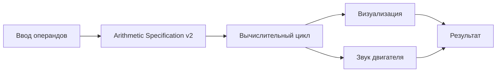

## 11. Методика и источники данных

| Величина | Происхождение | Статус |
|---|---|---|
| Время вычислительного цикла, 9 000 000 000 нс | задано в программе | точное |
| Время стандартного калькулятора, 180 000 000 нс | оценка | не измерено |
| Память Calculator 2, 2 МБ | оценка | не измерено |
| Память стандартного калькулятора, 38 МБ | оценка | не измерено |
| Память Electron-калькулятора, 4096 МБ | оценка | не измерено |
| Формулы Arithmetic Specification v2 | заданы в программе | точные |
| Накопленное время в разделе 7 | произведение времени на число операций | расчёт |

Для получения измеренных значений используйте диспетчер задач, `hyperfine` (время запуска) или `perf` (профилирование).

## 12. Лицензия

Свободное использование.